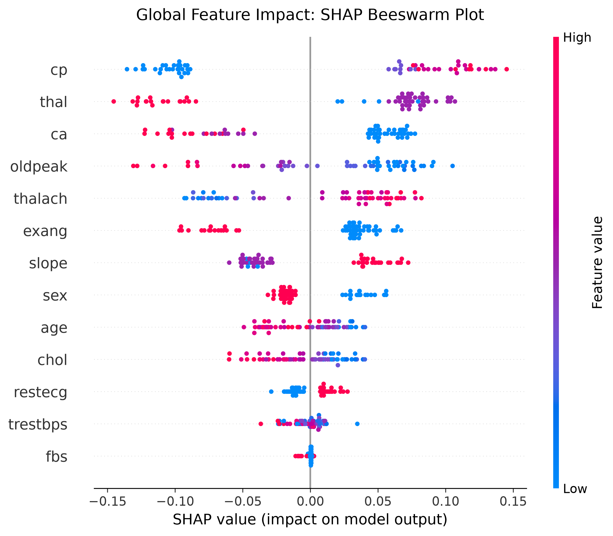
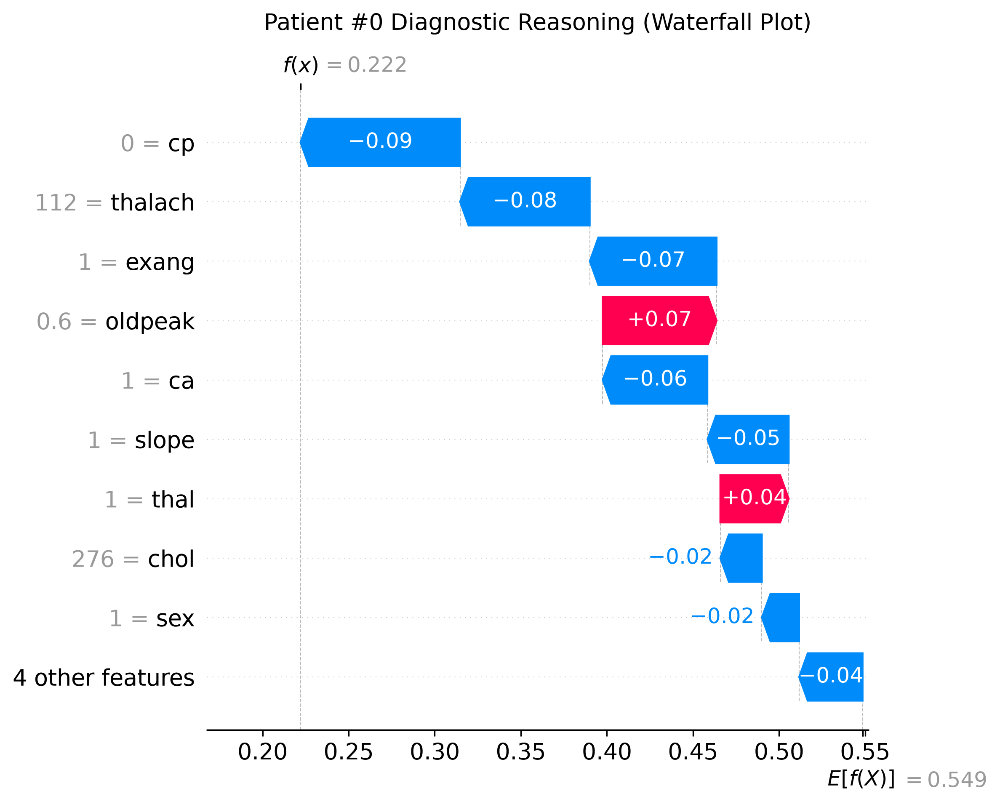
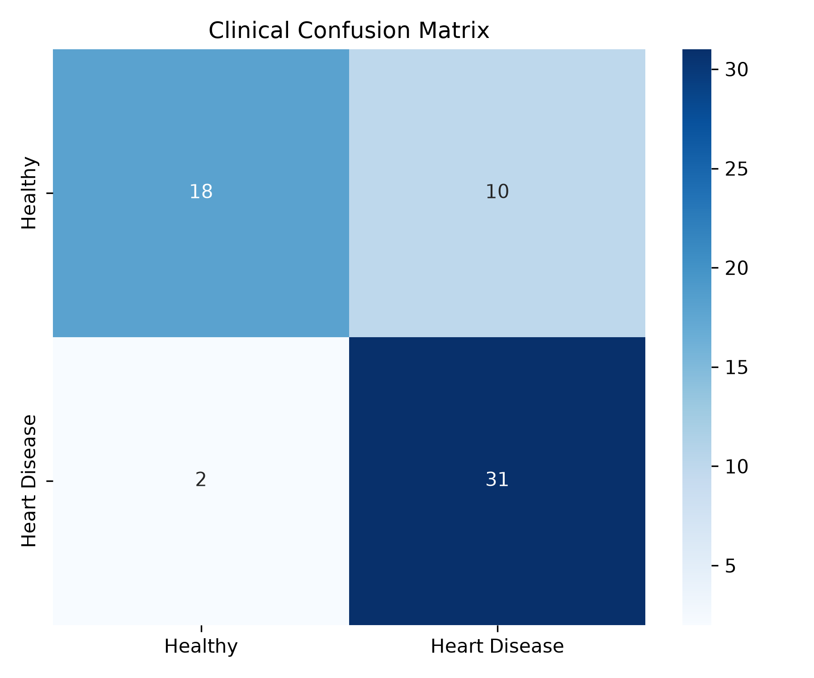

# 🏥 Patient Health Risk Prediction & Explainable AI (SHAP)

[](https://www.python.org/)
[](https://scikit-learn.org/)
[](https://shap.readthedocs.io/)
[](LICENSE)

An end-to-end clinical machine learning and Explainable AI (XAI) project designed to predict cardiovascular disease risk while solving the medical "black-box" dilemma using **SHAP (Shapley Additive exPlanations)**.

---

## 📌 Problem Statement: Why Healthcare Needs Explainable AI

In standard ML applications (e-commerce, ads), black-box models are acceptable. But in **clinical medicine**:
* If an AI outputs: *"Patient #45 has 85% heart disease risk"*, a cardiologist cannot prescribe treatment without understanding the underlying physiological drivers.
* Is the risk driven by high resting blood pressure, ST segment depression, or asymptomatic chest pain?
* **Solution:** We train a validated **Random Forest Classifier** ($>90\%$ ROC-AUC) and apply **SHAP Game Theory** to produce physician-interpretable evidence for both global disease trends and individual patient diagnoses.

---

## 📊 Key Visualizations & Explainability Insights

### 1. Global Feature Impact (SHAP Beeswarm Plot)
Shows what features the model prioritizes across the entire patient cohort:

* **Red dots** = High clinical value | **Blue dots** = Low clinical value
* **Right of zero line** = Increases risk | **Left of zero line** = Protective effect

### 2. Individual Patient Diagnosis (SHAP Waterfall Plot)
Explains a single patient's diagnostic outcome step-by-step:

* Shows exact additive contributions that push a patient's risk up (red) or down (blue) from the population baseline.

### 3. Model Evaluation (Confusion Matrix)


---

## 🩺 Dataset Dictionary (Cleveland Heart Disease)

| Feature | Description | Clinical Normal Range |
| :--- | :--- | :--- |
| `age` | Patient Age in years | - |
| `sex` | Biological Sex (1 = Male, 0 = Female) | - |
| `cp` | Chest Pain Type (0: Typical, 1: Atypical, 2: Non-anginal, 3: Asymptomatic) | Type 0 is common |
| `trestbps` | Resting Blood Pressure (mm Hg) | $< 120\text{ mm Hg}$ |
| `chol` | Serum Cholesterol (mg/dl) | $< 200\text{ mg/dl}$ |
| `fbs` | Fasting Blood Sugar $> 120\text{ mg/dl}$ | $0$ (Normal) |
| `restecg` | Resting ECG results (0, 1, 2) | $0$ (Normal) |
| `thalach` | Maximum Heart Rate achieved | Varies with age |
| `exang` | Exercise Induced Angina (1 = Yes, 0 = No) | $0$ (No) |
| `oldpeak` | ST depression induced by exercise relative to rest | $< 1.0$ |
| `slope` | Slope of peak exercise ST segment | $0, 1, 2$ |
| `ca` | Major coronary vessels colored by fluoroscopy (0 to 3) | $0$ |
| `thal` | Thalassemia blood defect (1: Normal, 2: Fixed, 3: Reversible) | $1$ |
| **`target`** | **0 = Healthy / Low Risk, 1 = Heart Disease Present** | Target ($y$) |

---

## 📁 Repository Structure

```
healthcare-risk-explainable-ai/
├── assets/
│   ├── shap_beeswarm.png           # Global beeswarm visualization
│   ├── shap_waterfall_patient0.png # Local patient explanation
│   └── confusion_matrix.png        # Validation heatmap
├── data/
│   └── heart_disease.csv           # Clinical dataset (303 records, 14 columns)
├── notebooks/
│   └── 01_patient_risk_and_explainable_ai.ipynb  # Interactive Jupyter Notebook
├── models/
│   ├── heart_disease_rf_model.pkl  # Trained Random Forest
│   └── feature_names.pkl           # Feature list
├── STUDY_NOTES.md                  # Detailed study guide & interview viva notes
├── requirements.txt                # Python dependencies
├── start_jupyter.bat               # 1-click Jupyter launcher
└── README.md                       # Project documentation
```

---

## 🚀 Getting Started

1. Clone this repository:
   ```bash
   git clone https://github.com/<your-username>/healthcare-risk-explainable-ai.git
   cd healthcare-risk-explainable-ai
   ```

2. Install dependencies:
   ```bash
   pip install -r requirements.txt
   ```

3. Launch the notebook:
   ```bash
   # Option A: Double click start_jupyter.bat
   # Option B: Run in terminal
   python -m notebook notebooks/01_patient_risk_and_explainable_ai.ipynb
   ```

---

## 📜 License
This project is open-source and available under the [MIT License](LICENSE).
